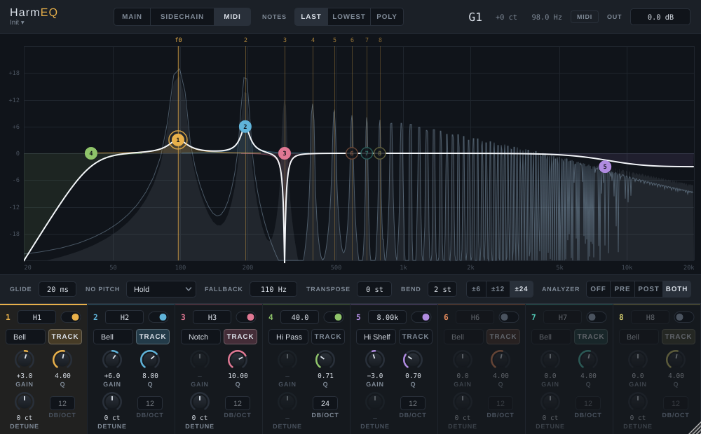

# HarmEQ

A pitch-tracking harmonic EQ plugin (VST3, plus a Standalone app) for macOS and Windows, built with JUCE. EQ bands follow the
fundamental of a monophonic note — detected from the main input, a sidechain, or taken from MIDI — and sit
on a chosen harmonic of it. See [PLAN.md](PLAN.md) for the design and milestones.

## Building

Requires CMake ≥ 3.22 and a C++20 compiler. JUCE and Catch2 are fetched automatically.

```sh
cmake -S . -B build -DCMAKE_BUILD_TYPE=Release
cmake --build build --config Release
ctest --test-dir build -C Release
```

Plugins are written to `build/HarmEQ_artefacts/Release/`. Add `-DHARMEQ_COPY_PLUGIN=ON` to the configure
step to also copy the VST3 into the system plugin folder (`~/Library/Audio/Plug-Ins/VST3` on macOS,
`C:\Program Files\Common Files\VST3` on Windows, which needs an elevated shell).
Add `-DCMAKE_OSX_ARCHITECTURES="arm64;x86_64"` for a universal binary.

macOS is the primary platform; Windows builds and passes validation in CI. The code also builds on Linux (used for development and tests) after
installing the JUCE dependencies:

```sh
sudo apt-get install libasound2-dev libfreetype-dev libfontconfig1-dev libx11-dev libxrandr-dev \
  libxinerama-dev libxcursor-dev libxext-dev libgl1-mesa-dev
```

## Current status



Done: the EQ bands, MIDI pitch tracking, and the GUI with its spectrum analyzer. Audio pitch detection
(Main Input / Sidechain sources) is not implemented yet. With those sources selected, tracked bands
behave as if no note is playing (see *No pitch*).

## Using the GUI

The display shows the combined EQ curve (white), each band's curve in its colour, and lines at the
first 8 harmonics of the current pitch. The note readout uses Ableton's octave numbering (MIDI 60 = C3).

| On the display | Does |
|---|---|
| Drag a node left/right | Tracked band: moves between harmonics (¼, ½, 1…32). Fixed band: sets Hz |
| Shift + drag left/right | Tracked band: fine detune (±100 ct). Fixed band: fine Hz |
| Drag up/down | Gain (bell and shelves) |
| Mouse wheel on a node | Q |
| Double-click a node | Band on/off |
| Double-click empty space | Turns on the next free band at that harmonic |
| Right-click a node | Curve, Track pitch, slope, on/off, reset |

Knobs and value boxes drag up/down (Shift for fine) and reset on double-click. Window size, display range
and analyzer mode are saved with the project.

`build/HarmEQScreenshot out.png` renders the editor with example settings and a held MIDI note, which
is handy for checking GUI changes without a host.

## Trying it in Ableton Live

1. Build with `-DHARMEQ_COPY_PLUGIN=ON` (or copy `HarmEQ.vst3` by hand), then in Live open
   *Settings → Plug-Ins*, make sure VST3 is enabled and click *Rescan*.
2. Put **HarmEQ** on an audio track with a sustained sound (a pad, drone, or noise works well for hearing it).
3. Open the plugin window and set **Source** to **MIDI**.
4. Make a band audible — the defaults are flat (0 dB). For example Band 1: Gain **+12 dB**, Q **10**,
   Harmonic **2**. Turn Glide up to taste.
5. Create a MIDI track. In its *MIDI To* dropdown choose the audio track, and in the second dropdown choose
   **HarmEQ**. Play a clip, or set the MIDI track's Monitor to *In* and play your keyboard.

Each note moves the tracked bands to its harmonics; releasing all notes keeps the last pitch (*Hold*),
returns to *Fallback Pitch*, or fades the tracked bands out (*Bypass Bands*), depending on No-Pitch Mode.
